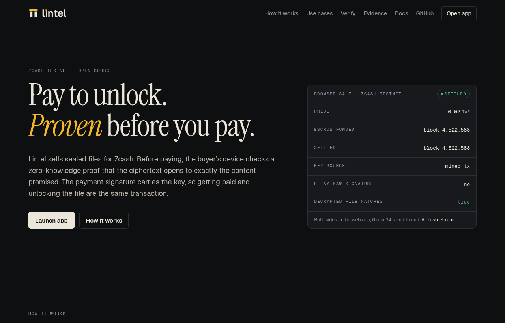
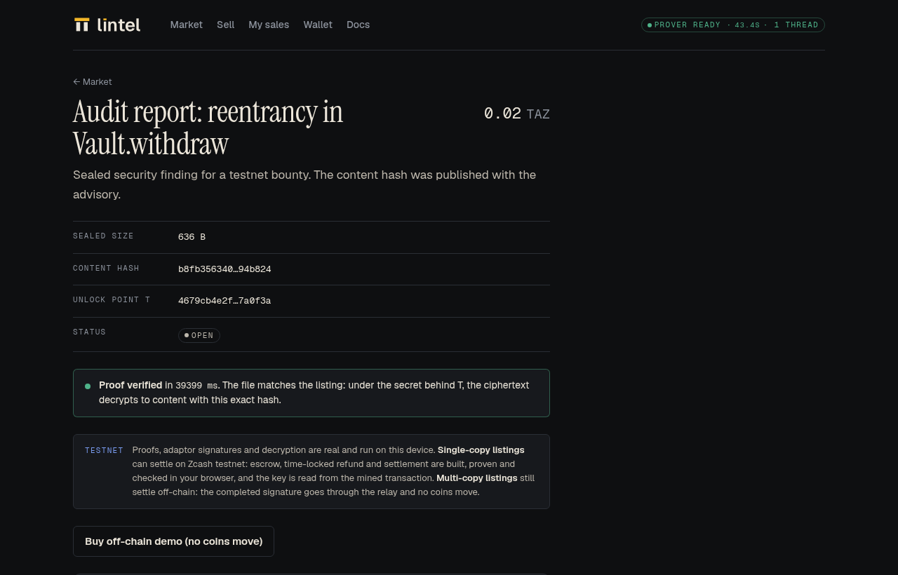
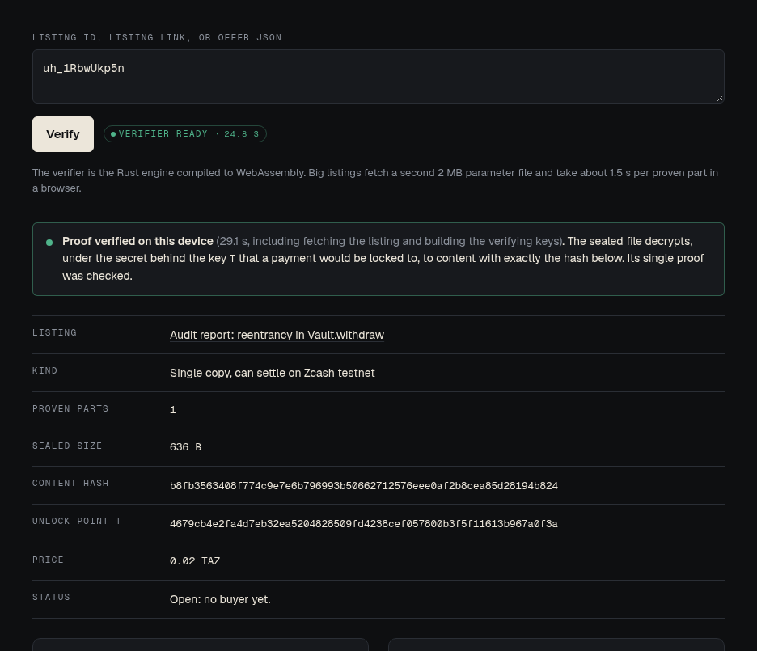
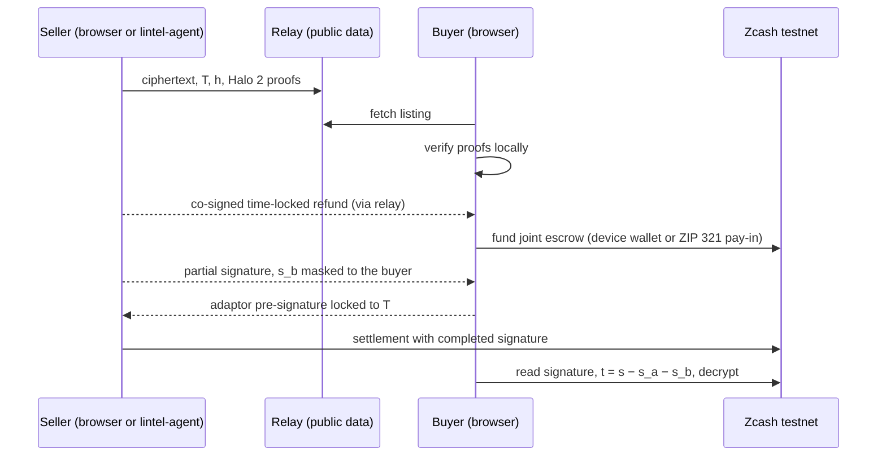

<p align="center">
  
  
</p>

<h3 align="center">Sell a sealed file. The buyer checks a proof before paying, and the payment hands over the key.</h3>

<p align="center">
  <a href="https://lintel-godwin-web3s-projects.vercel.app/app">App</a> ·
  <a href="https://lintel-godwin-web3s-projects.vercel.app/verify">Verify</a> ·
  <a href="https://lintel-godwin-web3s-projects.vercel.app/docs">Docs</a> ·
  <a href="https://lintel-godwin-web3s-projects.vercel.app/whitepaper">Whitepaper</a> ·
  <a href="https://lintel-godwin-web3s-projects.vercel.app/evidence">Evidence</a>
</p>

<p align="center"><b>Zcash testnet only · unaudited · no mainnet until testnet is solid and reviewed</b></p>

[](https://lintel-godwin-web3s-projects.vercel.app)

Lintel is private conditional settlement on Zcash. A seller seals a file in their browser and publishes a Halo 2 proof that the ciphertext decrypts, under the secret behind a public point `T`, to content with hash `h`. The buyer verifies that proof on their own device (Rust compiled to WebAssembly), then funds a shielded escrow that neither side can spend alone, from the in-browser wallet or from any testnet wallet through a ZIP 321 request. To get paid, the seller (or `lintel-agent`, while the seller is offline) completes a two-party adaptor signature, and that signature reveals the key on chain. If the seller never settles, a refund co-signed before funding becomes valid after its `nLockTime`.

No trusted setup, no custodian, no server-side keys. Files up to 1,523,681 bytes, every byte's decryption proven (offer v3: up to 64 parts at k = 15).

## What works today

Every row below runs on Zcash testnet (NU7, Ironwood pool, v6 transactions). Transaction links open on the public relay's lightwalletd proxy, which returns the raw transaction and its block. Records: [`docs/testnet/*.json`](docs/testnet).

| Feature | Status | Testnet proof |
| --- | --- | --- |
| Seal and prove a file in the browser (Halo 2, IPA over Pasta, no trusted setup) | Works | [How it works](docs/how-it-works.md) |
| Payloads up to 1,523,681 bytes, every byte proven | Works | [Big payloads](docs/big-payloads.md) |
| Proven claims: length bounds, magic prefix, bytes at an offset, proven in the same proof as the decryption and shown to the buyer | Works in the browser (seal, relay check, buyer verifies); no claims-carrying sale mined yet | [Proven claims](docs/predicates.md) |
| Public proof check with no wallet at `/verify` | Works | [Verify](https://lintel-godwin-web3s-projects.vercel.app/verify) |
| Browser sale: joint escrow, adaptor-signed settlement, key read from the mined transaction | Works, mined | funding [`75053762c1…`](https://lintel-relay.onrender.com/chain/tx/75053762c15aea7b27fad758928fc3009ca86d5ee3a10e35b17162914c302534) (4,522,583), settlement [`c51697ebe0…`](https://lintel-relay.onrender.com/chain/tx/c51697ebe0767395dee5fc54f246eccf53dc2e071f5690808ec77776939b2b67) (4,522,588) |
| Refund after the lock (browser) | Works, mined | refund [`992163c4a2…`](https://lintel-relay.onrender.com/chain/tx/992163c4a20b3cc2e363b3720aeac8f25162c81bc795736d285b0b1bd3e43392) (4,522,635, `nLockTime` 4,522,631) |
| Time lock enforced by consensus (early refund rejected, mined after the lock) | Works, mined | refund [`e78f088e5b…`](https://lintel-relay.onrender.com/chain/tx/e78f088e5bae544378439cf8e665fca72abe1f0f1157feaf0167acf1502963b8) (4,522,335) |
| Seller agent `lintel-agent`, seller's browser closed | Works, mined | settlement [`5104f5af57…`](https://lintel-relay.onrender.com/chain/tx/5104f5af5766142cdeeba4d742b24c37149cbfdeaadbe51dd501d99e7c9aacc2) (4,529,908) |
| Key stays with the buyer: seller's share masked to the buyer, session records served only to buyer and seller | Works, mined | settlement [`bd7d9d69db…`](https://lintel-relay.onrender.com/chain/tx/bd7d9d69db555eeb21170a77d36c16332f06d39eb900c34658eb906055d00cdc) (4,531,887) |
| Pay from another wallet, transparent receiver | Works, mined | payment [`d38a395f17…`](https://lintel-relay.onrender.com/chain/tx/d38a395f17644f8c27598ac5a0c5ae6c6d287dbb872ff52b793bce7b2c25e3ed) (4,529,992), settlement [`f765cb4e12…`](https://lintel-relay.onrender.com/chain/tx/f765cb4e12f3a2fa22d7afb0c6d1973a4372351460990222f72fae26405ec628) (4,530,002) |
| Pay from another wallet, Orchard receiver (Ironwood note) | Works, mined | payment [`7375623f73…`](https://lintel-relay.onrender.com/chain/tx/7375623f73840a1e0c5c9becc4c818fb1f7233e72899839f377fdfbc33b91bd2) (4,530,006), settlement [`a7575c5e61…`](https://lintel-relay.onrender.com/chain/tx/a7575c5e61915887f8ccdd14a9cd68a7c05c155387aa8fce858ead3f5aadcf9a) (4,530,013) |
| Multi-copy listings, buyers order while the seller is offline | Works, off-chain only (no coins move) | [How it works](docs/how-it-works.md#6-multi-copy-presale-listings) |

A browser sale with both sides in the web app took 6 minutes 34 seconds end to end. All runs: [Testnet evidence](docs/testnet-evidence.md).

<table>
  <tr>
    <td width="50%"></td>
    <td width="50%"></td>
  </tr>
  <tr>
    <td>A listing after the buyer's browser verified its Halo 2 proof.</td>
    <td>Anyone can check a listing at <code>/verify</code>, no wallet needed.</td>
  </tr>
</table>

## Not yet

| Item | State |
| --- | --- |
| Mainnet | Not planned until testnet is solid and reviewed; see the [Production gate](docs/production.md) |
| External audit | Not done |
| On-chain settlement for multi-copy listings | Not done: they settle through the relay and move no coins |
| Exclusivity after a sale | Not enforceable: outsiders can no longer compute the key (the seller's partial signature is masked to the buyer), but the buyer can still share what it bought, and sales settled before the fix are exposed ([threat model](docs/threat-model.md#after-the-sale)) |
| Refund backup | Not done: the signed refund lives only in the buyer's browser storage |
| Hosted seller agent | Not offered: the agent holds the listing's secrets, so it runs on the seller's machine |
| Full wallet | Not done: the device wallet only knows notes scanned in by txid |
| More claim types | Signed attestations and dataset predicates are designs only ([proven claims](docs/predicates.md)); claims need offer v3, byte claims must sit in the first 23,777 bytes, and the SDK and MCP server do not expose claims yet |
| Fast big-file sealing in a browser tab | About 100 s per 23.8 KB part single-threaded (1 MB: over an hour); 1 MB took 9.5 minutes natively on 2 vCPU |

Full status: [What ships when](docs/what-ships-when.md).

## How it works



Read more: [Whitepaper](docs/whitepaper.md) · [Protocol](docs/how-it-works.md) · [Threat model](docs/threat-model.md) · [How Lintel compares](docs/compare.md).

## Try it

- **Two minutes, no wallet:** seal a line of text in the [app](https://lintel-godwin-web3s-projects.vercel.app/app), then check its proof at [/verify](https://lintel-godwin-web3s-projects.vercel.app/verify). [Quickstart](docs/quickstart.md#in-two-minutes)
- **Full sale:** two browser profiles and some faucet TAZ. [Quickstart](docs/quickstart.md#full-sale-on-testnet)
- **Test it and report what breaks:** [tester guide](https://lintel-godwin-web3s-projects.vercel.app/testers) · [open an issue](https://github.com/Godwin-web3/lintel/issues/new?template=bug_report.md)

## Build on Lintel

| Package | What |
| --- | --- |
| [`lintel-sdk`](packages/sdk) | TypeScript SDK (Node and browser): seal and list, verify proofs, fund (in-app wallet or ZIP 321), watch, settle, refund. [Reference](docs/sdk.md) |
| [`create-lintel-app`](packages/create-lintel-app) | `npm create lintel-app`: a Vite starter that verifies and buys a listing on testnet |
| [`lintel-mcp`](packages/mcp) | MCP server: AI agents browse, verify, buy and sell under owner-set spending limits; keys stay server-side. [Guide](docs/agents.md) |
| [`examples/`](examples) | Seller CLI, buyer verify-and-buy, AI agent, off-chain rehearsal |

```js
import { createLintel } from 'lintel-sdk';
const lintel = await createLintel();                  // hosted testnet relay
await lintel.verify(listingId);                       // Halo 2 proof checked locally
for await (const s of lintel.buy(listingId, { funding: 'payin' }).watch()) {
  if (s.payment) console.log(s.payment.uri);          // pay from any testnet wallet (ZIP 321)
  if (s.done) console.log(new TextDecoder().decode(s.plaintext));
}
```

The packages are not on npm yet; build them from this repo (`npm install && npm run build` at the root; the SDK's WASM with `npm run build:wasm -w lintel-sdk`). A full on-chain sale driven only by the SDK is recorded in [docs/testnet/evidence-sdk-sale.json](docs/testnet/evidence-sdk-sale.json).

## Architecture

```
lintel/
  engine/            Rust crate `lintel`: adaptor signatures, Halo 2 circuits (sealed, sealed_multi,
                     sealed_big, disclosure), presale, chain (escrow, PCZT checks, refunds, ZIP 321),
                     seller agent; binaries lintel-cli, lintel-chain, lintel-agent
  wasm/              The engine for the browser (crate `lintel-wasm`), optional threaded build
  web/relay/         Public-data relay and lightwalletd proxy (Node); never sees keys, t or plaintext
  web/app/           Site, marketplace (/app), public verifier (/verify) and docs (React + Vite)
  packages/          TypeScript: lintel-sdk, lintel-mcp (MCP server), create-lintel-app (Vite starter)
  examples/          Runnable SDK examples: seller, buyer, AI agent, off-chain rehearsal
  docs/              Documentation, whitepaper, blog, testnet records (docs/testnet/*.json)
  brand/             Brand kit: logos, tokens.css, fonts
```

Details: [Architecture](docs/architecture.md).

## Local development

```sh
# engine tests and a demo
cd engine && cargo test --release
cargo run --release --bin lintel-cli -- sealed-demo

# relay (Node 20+)
cd web/relay && npm test && node server.js        # http://localhost:8787

# app (Rust, wasm-pack and clang for the on-chain engine)
cd web/app && npm ci && npm run wasm && npm run wasm:chain
VITE_RELAY_URL=http://localhost:8787 npm run dev
npm run check:links && npm run build
```

Self-host the relay (Render + Upstash) and the app (Vercel): [Self-hosting](docs/self-hosting.md). CLI and seller agent: [CLI reference](docs/cli.md).

## Security and contact

Lintel is testnet software and has not been audited; do not use it with real funds. Report vulnerabilities privately as described in [SECURITY.md](SECURITY.md), not in public issues. Bugs, questions and ideas: [GitHub issues](https://github.com/Godwin-web3/lintel/issues). Contributing: [CONTRIBUTING.md](CONTRIBUTING.md) and the [Code of Conduct](CODE_OF_CONDUCT.md).

## License

Licensed under either of Apache License, Version 2.0 ([LICENSE-APACHE](LICENSE-APACHE)) or MIT license ([LICENSE-MIT](LICENSE-MIT)), at your option. Unless you explicitly state otherwise, any contribution you submit for inclusion is dual licensed as above, without additional terms. Brand fonts are under the SIL Open Font License.
