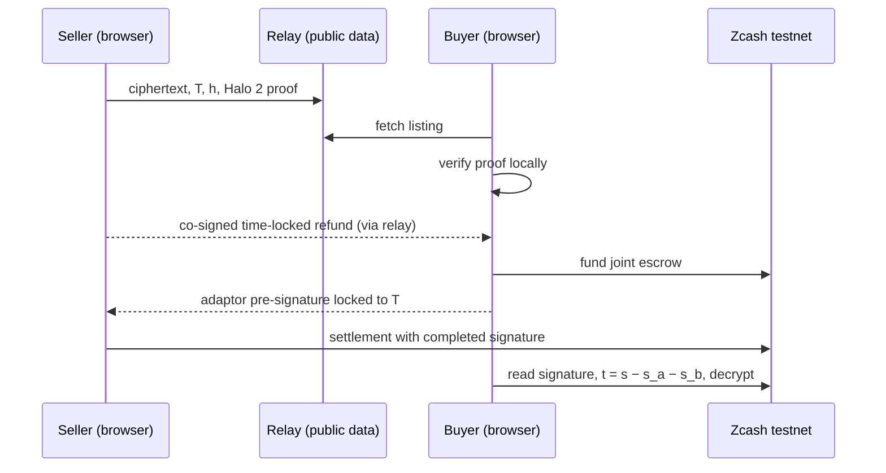

<p align="center">
  
  
</p>

<h3 align="center">Pay to unlock. Proven before you pay.</h3>

<p align="center"><b>Pay only for what's proven.</b></p>

<p align="center">
  Private, conditional settlement on Zcash. The transaction that pays the seller is the transaction that hands the buyer the key.
</p>

<p align="center">
  <a href="https://lintel-godwin-web3s-projects.vercel.app">App</a> ·
  <a href="https://lintel-godwin-web3s-projects.vercel.app/how-it-works">How it works</a> ·
  <a href="https://lintel-godwin-web3s-projects.vercel.app/docs">Docs</a> ·
  <a href="docs/testnet-evidence.md">Testnet evidence</a> ·
  <a href="SECURITY.md">Security</a>
</p>

> **Testnet only, unaudited.** Don't use Lintel with real funds.

## What it does

A seller seals a file (a bug report, a dataset, research) in their browser and publishes a zero-knowledge proof that the ciphertext opens to content with a stated hash. A buyer verifies that proof on their own device, then pays into a shielded Zcash escrow. To claim the payment, the seller must complete an adaptor signature that publishes the decryption key on-chain. If the seller never claims, a refund the seller co-signed in advance becomes valid after a lock height.

- **Proven before you pay.** Halo 2 proof that the ciphertext decrypts, under the secret behind `T`, to content with hash `h`. No trusted setup.
- **Atomic.** Two-party adaptor signatures over Orchard's spend-auth group: payment and key release are one transaction.
- **Refundable.** v2 refunds are time-locked by consensus (`nLockTime`), so they can't race the seller's claim.
- **Every byte proven.** Listings hold up to 1,523,681 bytes (about 1.5 MB); files over 1,953 bytes are proven in 23.8 KB parts, and the buyer verifies every part before paying ([big payloads](docs/big-payloads.md)).
- **Pay from any wallet, sell with the tab closed.** Buyers fund the escrow from the in-browser wallet or from any Zcash testnet wallet through a ZIP 321 request (shielded or transparent). Sellers can hand an on-chain listing to the seller agent (`lintel-agent`), which finishes the sale with their browser closed.
- **Private by construction.** Keys, signing shares, `t` and plaintext never reach the relay. Proving, signing and transaction building run in the browser (Rust → WebAssembly), or in the seller agent on a machine the seller controls. The relay only passes public messages.
- **Live on testnet.** Browser sale mined at 4,522,583 (funding) and 4,522,588 (settlement); seller-agent sale at 4,529,902 and 4,529,908; sales paid from another wallet at 4,529,992–4,530,013. See [evidence](docs/testnet-evidence.md).

## How it works



Read more: [How it works](docs/how-it-works.md) · [Architecture](docs/architecture.md) · [Security model](docs/security-model.md).

## Quickstart

Use the hosted app: <https://lintel-godwin-web3s-projects.vercel.app>. Get testnet TAZ from a faucet and follow the [Quickstart](docs/quickstart.md).

Run it locally:

```sh
# engine tests and demos
cd engine && cargo test --release
cargo run --release --bin lintel-cli -- sealed-demo

# relay (Node 20+; tests: npm test)
cd web/relay && node server.js            # http://localhost:8787

# app
cd web/app && npm ci && VITE_RELAY_URL=http://localhost:8787 npm run dev
```

Self-host the relay (Render + Upstash) and app (Vercel): [docs/self-hosting.md](docs/self-hosting.md). CLI reference: [docs/cli.md](docs/cli.md).

## Repository

| Path | What |
| --- | --- |
| [`engine/`](engine) | Rust crate: adaptor signatures, Halo 2 circuits, sealed goods, presale, chain, seller agent, CLIs |
| [`wasm/`](wasm) | The engine for the browser |
| [`web/relay/`](web/relay) | Public-data relay and chain proxy (Node) |
| [`web/app/`](web/app) | Site pages, marketplace and docs (React + Vite) |
| [`docs/`](docs) | Documentation |
| [`brand/`](brand) | Brand kit |

## Status and limits

Working on testnet today: single-copy listings with on-chain escrow, settlement and time-locked refund; funding from the in-browser wallet or from any testnet wallet via ZIP 321 (transparent or shielded); the seller agent (`lintel-agent`) for sales with the seller's browser closed; multi-copy presale listings (settled off-chain for now); payloads up to 1,523,681 bytes with every byte's decryption proven (files over 1,953 bytes in 23.8 KB proven parts whose ciphertext and proofs the relay stores by content address, [big payloads](docs/big-payloads.md)); optional multithreaded proving.

Not yet: mainnet, an audit, on-chain presale settlement, a hosted seller agent, and a full wallet. Big files are slow to seal in a single-threaded browser tab (about 100 s per 23.8 KB part). Details in the [security model](docs/security-model.md#known-limits).

## Contributing

See [CONTRIBUTING.md](CONTRIBUTING.md) and the [Code of Conduct](CODE_OF_CONDUCT.md). Report vulnerabilities privately per [SECURITY.md](SECURITY.md).

## License

Licensed under either of

- Apache License, Version 2.0 ([LICENSE-APACHE](LICENSE-APACHE))
- MIT license ([LICENSE-MIT](LICENSE-MIT))

at your option. Unless you explicitly state otherwise, any contribution you submit for inclusion is dual licensed as above, without additional terms. Brand fonts are under the SIL Open Font License.
