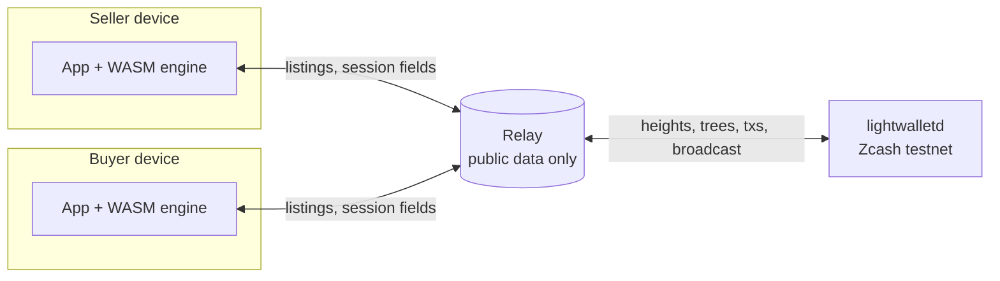

# Architecture

Lintel has four parts, plus an optional seller agent. All cryptography runs on the user's own devices; the only server is a relay for public data.

## Components

| Part | Path | What it does |
| --- | --- | --- |
| **Engine** | `engine/` | Rust crate `lintel`. `protocol.rs` (two-party adaptor signatures over Orchard's RedPallas spend-auth group), `disclosure.rs` (Halo 2 min-value disclosure), `sealed.rs` / `sealed_multi.rs` (verifiable encryption: proof that a ciphertext opens under `t` to content with hash `h`), `presale.rs` (multi-copy sales), `sealed_big.rs` (offer v3: proven 23.8 KB parts), `chain.rs` + `lwd.rs` (escrow, PCZT spends, refunds, ZIP 321 pay-in, lightwalletd client; `net` feature), `agent.rs` (seller agent; `agent` feature), `service.rs`. Binaries: `lintel-cli`, `lintel-chain`, `lintel-agent`, `lintel-inject`. |
| **WASM** | `wasm/` | Crate `lintel-wasm`, the engine compiled to WebAssembly for the browser: `Merchant` (seller) and `Payer` (buyer) for seal, verify, pre-sign, complete and unlock; `chain.rs` / `v2.rs` for in-browser escrow and settlement; `threads.rs` for optional multithreaded proving. |
| **Relay** | `web/relay/` | Small Node server. Stores listings, write-once session fields and presale orders (Upstash Redis or a JSON file), and proxies public chain calls to lightwalletd. |
| **App** | `web/app/` | React + Vite. Landing page at `/`, site pages at `/how-it-works`, `/use-cases` and `/evidence`, marketplace at `/app`, docs at `/docs`. Proving runs in a Web Worker. |
| **Seller agent** (optional) | `engine/src/bin/lintel-agent.rs` | Native process the seller runs on a machine they control. It imports a handoff file from the app and does the seller's side of an on-chain sale with the browser closed, talking to the relay and to lightwalletd directly. See [CLI reference](cli.md#lintel-agent-seller-agent). |

## A single-copy sale, end to end

1. **Seal.** The seller's browser picks a fresh `t`, encrypts the content, and proves (Halo 2) the ciphertext opens under `t` to content with hash `h`. It posts ciphertext, `T`, `h`, proof and price to the relay. `t` stays on the device.
2. **Verify.** The buyer's browser downloads the listing and verifies the proof locally.
3. **Set up the escrow.** Both browsers exchange key contributions with proofs of knowledge through the relay and derive the joint escrow address. The seller co-signs a time-locked refund for the buyer first.
4. **Fund.** The buyer's wallet builds, proves and broadcasts the funding transaction through the relay's chain proxy. A buyer paying from another wallet first pays a ZIP 321 request to a per-purchase pay-in wallet; the app funds the escrow straight from that payment.
5. **Pre-sign.** The buyer sends an adaptor pre-signature on the settlement, locked to `T`.
6. **Settle.** The seller's app, or the seller agent, completes the signature with `t`, finalizes the PCZT and broadcasts. The seller is paid.
7. **Unlock.** The buyer fetches the mined settlement, extracts the completed spend-auth signature, computes `t` and decrypts. If step 6 never happens, the buyer broadcasts the refund once the lock height passes.

## Relay API

| Method | Path | Purpose |
| --- | --- | --- |
| GET | `/health` | Liveness |
| GET, POST | `/listings`, `/listings/:id` | List, create and read listings |
| POST | `/listings/:id/sessions` | Open a purchase session |
| GET | `/sessions/:id` | Read session fields |
| POST | `/sessions/:id/{partial,presig,signature,chain/:field}` | Write-once session fields |
| POST, GET | `/listings/:id/units`, `/listings/:id/units/:i`, `/listings/:id/orders` | Presale copies and orders |
| POST, GET | `/listings/:id/units/:i/orders`, `/orders/:id`, `/orders/:id/{complete,reject}` | Presale order lifecycle |
| PUT, GET | `/blobs/:sha256` | Content-addressed blobs for big (v3) offers: one part's ciphertext + proof each, refused unless the bytes hash to the name |
| GET | `/chain/height`, `/chain/tree/:h`, `/chain/cmxs/:h`, `/chain/tx/:txid` | Public chain data |
| GET | `/chain/utxos/:taddr`, `/chain/compact/:from/:to` | Pay-in wallet scanning: transparent coins and compact blocks (the browser re-checks each against the full transaction) |
| POST | `/chain/broadcast` | Broadcast a fully signed transaction |

## Performance (measured)

- Proving parameters (`params.bin`) are 524,356 bytes and pinned by digest.
- Sealing about 1 KB in the browser: about 28 s single-threaded, about 15 s with two threads (`LINTEL_THREADS=1` build). Verification is under a second.
- Payload caps: 1,953 bytes per single proof, 7,905 bytes for a multi-proof presale copy, 1,523,681 bytes for a big (v3) offer of up to 64 proofs at k = 15 (second pinned file `params-big.bin`, 2,097,220 bytes). A 23.8 KB v3 part proves in 13.3 s natively (2 vCPU) and about 100 s in single-threaded WASM; see [Big payloads](big-payloads.md).

See [Presale, relay and proving](relay-perf.md) and [On-chain settlement](onchain.md) for full measurements.
